

  

<h1 align="center">Greenkeep</h1>

<strong>Grow the garden. Command the swarm.</strong>

  Lane defence with a garden you keep — lost raids steal your harvest, never the lawn you built.

  <a href="https://www.greenkeep.org/play"><strong>Play free</strong></a>
  ·
  <a href="https://www.greenkeep.org/">greenkeep.org</a>
  ·
  <a href="https://youtu.be/_sWoGF-cBxM">Trailer</a>
  ·
  <a href="media.html">Media kit</a>
  ·
  <a href="https://discord.gg/TpE6PCnMNK">Discord</a>

  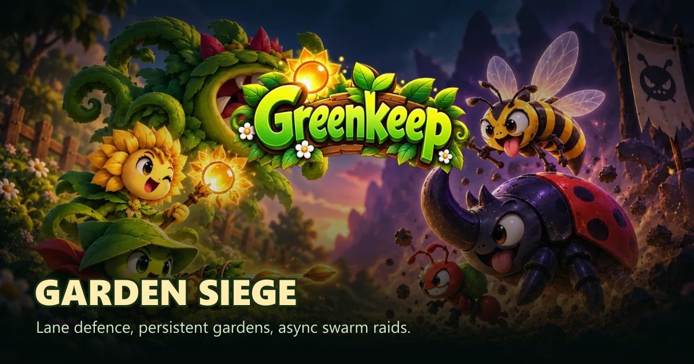

---

## What it is

Greenkeep is a free lane-defence game for browser and Android. You play both sides:

- **Plants** hold your permanent garden while you are away
- **Insects** are how you take someone else’s harvest

Scout a rival base, stack lanes, and break it while its keeper sleeps. Defenders never lose their layout — only unprotected storage.

| | |
| --- | --- |
| **Platforms** | Web browser · Android APK |
| **Price** | Free to play |
| **Roster** | 48 plants · 28 insects |
| **Contact** | [hello@greenkeep.org](mailto:hello@greenkeep.org) |

---

## Trailer

[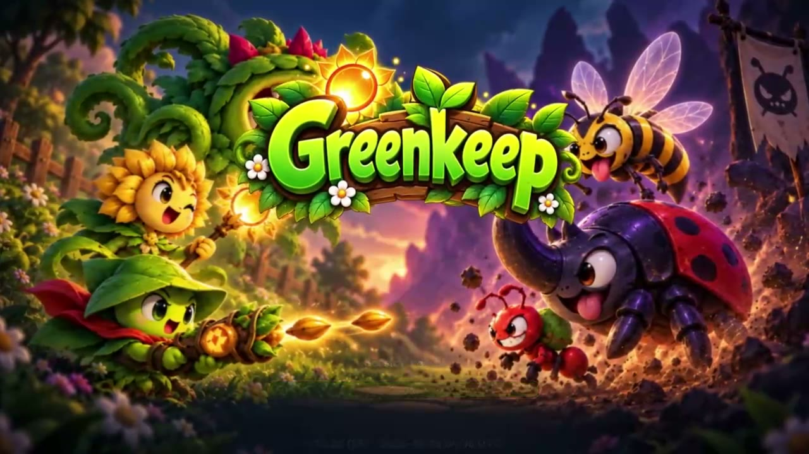](https://youtu.be/_sWoGF-cBxM)

**2:30** · in-game footage · [youtu.be/_sWoGF-cBxM](https://youtu.be/_sWoGF-cBxM)

Local teaser clip: [`media/video/intro-teaser.mp4`](media/video/intro-teaser.mp4)

---

## Screenshots

| Hub | Garden | Battle |
| :---: | :---: | :---: |
| 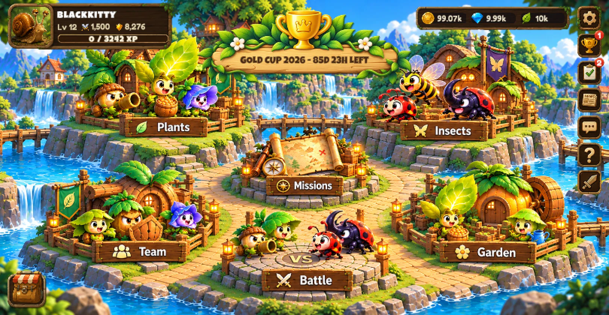 | 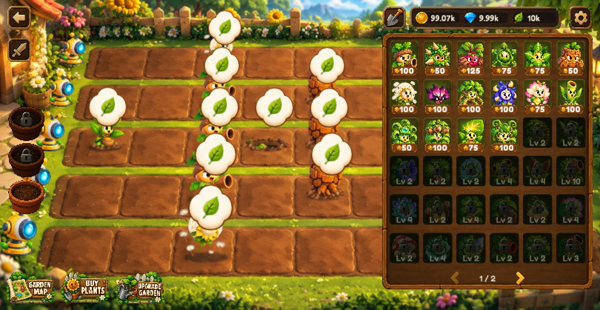 | 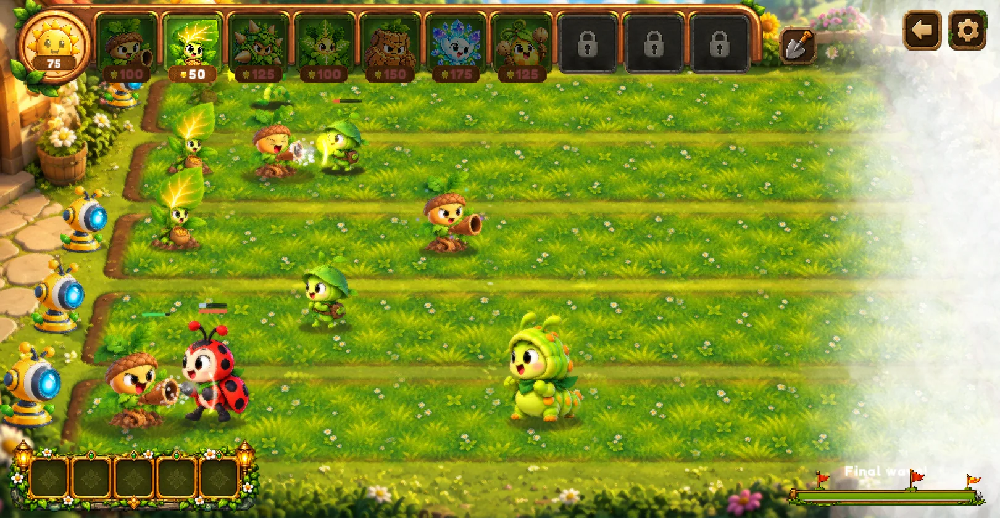 |
| Village hub | Permanent garden | Sunlit Lawn defence |

| Raid | Plants | Insects |
| :---: | :---: | :---: |
| 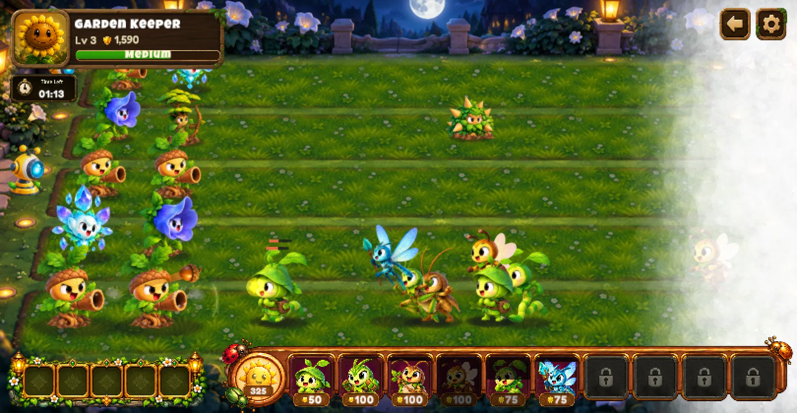 | 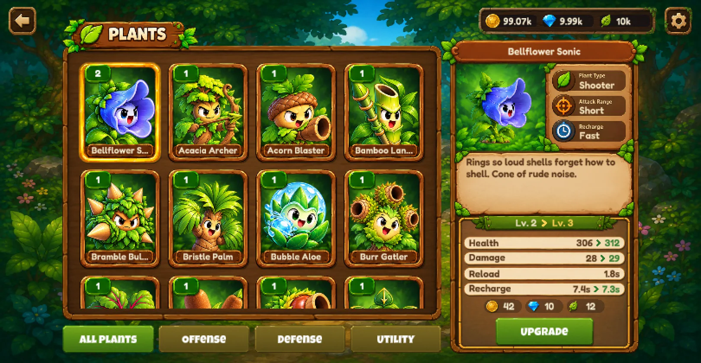 | 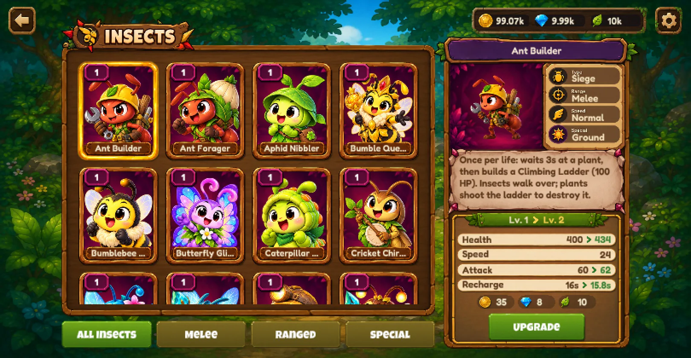 |
| Moonlit Lawn raid | Plant roster | Hatchery |

More shots (missions, team, Guardian, loading) live in [`media/screens/`](media/screens/).

---

## Maps

| Sunlit Lawn | Moonlit Lawn | Canal Lawn | Sky Terrace |
| :---: | :---: | :---: | :---: |
| 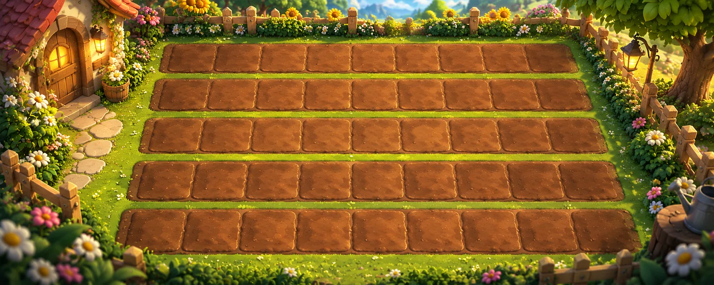 | 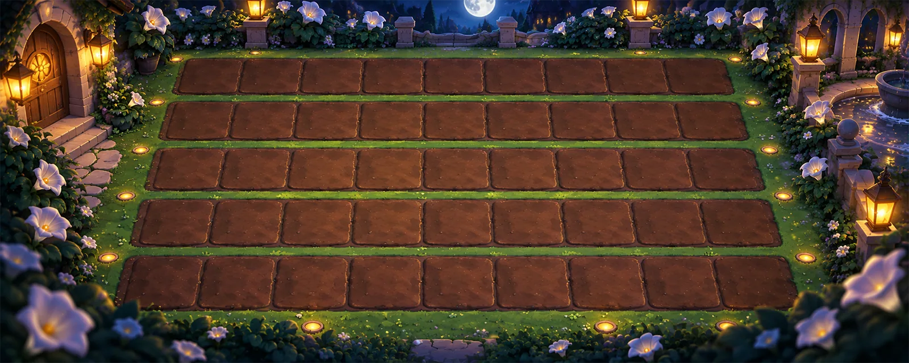 | 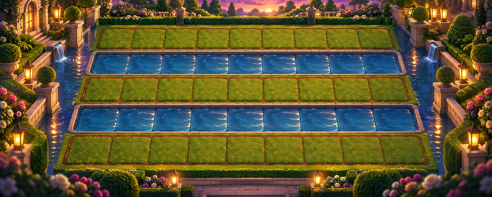 | 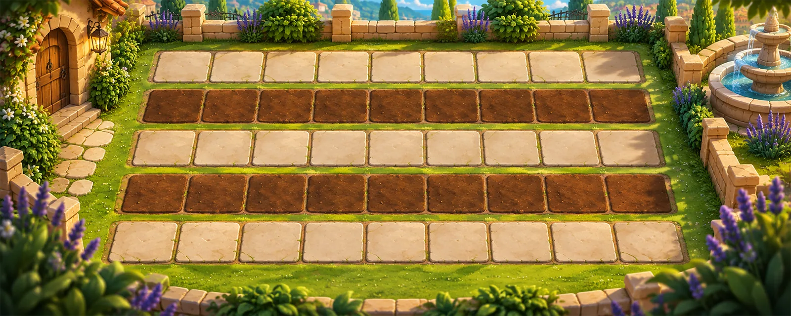 |

---

## How a session feels

1. **Story mode** — five chapters teach the lanes; clearing stages unlocks your roster  
2. **Build the garden** — plant once; raiders can steal harvest, never your layout  
3. **Async raids** — scout, deploy insects lane by lane, watch the three-minute fight resolve  
4. **Teams & Gold Cup** — 24-hour wars and seasonal Swiss pairings when you are ready

Deep dives on the live site: [Modes](https://www.greenkeep.org/modes) · [Battle guide](https://www.greenkeep.org/battle) · [Garden Codex](https://www.greenkeep.org/codex)

---

## This repository

Public marketing profile and media kit for Greenkeep.

| Path | Contents |
| --- | --- |
| [`index.html`](index.html) | Marketing landing page (GitHub Pages ready) |
| [`media.html`](media.html) | Trailer + filterable gallery |
| [`media/brand/`](media/brand/) | Logo, favicons, OG card, title art |
| [`media/screens/`](media/screens/) | In-game screenshots |
| [`media/maps/`](media/maps/) | Board / lawn art |
| [`media/art/`](media/art/) | Key art & loading art |
| [`media/video/`](media/video/) | Trailer teaser + posters |

**Play the game:** [www.greenkeep.org](https://www.greenkeep.org/)  
**Press / creators:** credit Greenkeep / KittyHome · extra assets via [hello@greenkeep.org](mailto:hello@greenkeep.org)

---

  <a href="https://www.greenkeep.org/play">Play in browser</a>
  ·
  <a href="https://www.greenkeep.org/download">Android</a>
  ·
  <a href="https://discord.gg/TpE6PCnMNK">Join Discord</a>

